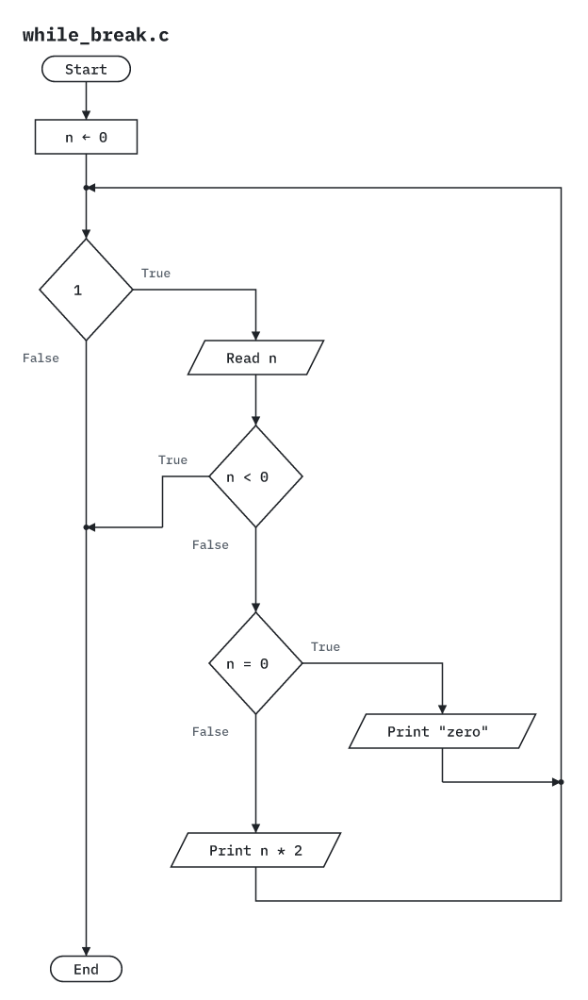

# c2flowch: C to flowchart (ANSI/ISO 5807)

**c2flowch** converts C source code into flowcharts with the ANSI/ISO 5807
symbols, as text (Unicode box drawing), SVG or PNG.

```c
int main() {
  int n = 0;
  while (1) {
    scanf("%d", &n);
    if (n < 0)
      break;
    if (n == 0) {
      puts("zero");
      continue;
    }
    printf("%d\n", n * 2);
  }
  return 0;
}
```



## How it works

The conversion has two steps, with a YAML file in between that you can edit
by hand:

1. `parse`: C source → YAML, one flowchart per function;
2. `render`: YAML → text, SVG or PNG.

The YAML is a tree of statements that follows the structure of the code.
Every text is the label printed in its symbol:

```yaml
title: while_break.c
lang: en
functions:
- name: main
  entry: true
  body:
  - process: n ← 0
  - while:
      cond: '1'
      body:
      - io: Read n
      - if:
          cond: n < 0
          then:
          - break
      - if:
          cond: n = 0
          then:
          - io: Print "zero"
          - continue
      - io: Print n * 2
  - return: '0'
```

| Statement                              | Symbol                         |
|----------------------------------------|--------------------------------|
| `process: text`                        | Process (rectangle)            |
| `io: text`                             | Data (parallelogram)           |
| `call: text`                           | Predefined process             |
| `prep: text`                           | Preparation (hexagon)          |
| `if`, `while`, `do_while`, `for`       | Decision (diamond)             |
| `switch` (`expr`, `cases`)             | Decision, one symbol per case  |
| `break`, `continue`, `goto`, `label`   | Lines to their target          |
| `return: value`                        | Terminator                     |

A `switch` case is `{values: [...], default: true|false, body: [...]}`.
Without a trailing `break`, it falls through into the next case, as in C.

## Usage

```bash
# 1. C → YAML (writes main.yaml)
c2flowch parse main.c --lang es --level 3

# 2. YAML → drawing
c2flowch render main.yaml                          # text, to the terminal
c2flowch render main.yaml -f svg -o main.svg
c2flowch render main.yaml -f png -o main.png
c2flowch render main.yaml -f svg -o main.svg -s    # one file per function
```

`--level` sets how much detail is drawn:

| Level | Shows                                                          |
|-------|----------------------------------------------------------------|
| 1     | Calls to functions of the file, and the structures around them |
| 2     | Every control structure, input/output and calls                |
| 3     | Level 2 plus assignments and other operations (default)        |
| 4     | Level 3 plus declarations without a value                      |
| 5     | Every statement in its own symbol (nothing is grouped)         |

`--lang` sets the language of the labels: `en` (default) or `es`.

`parse` reports what it cannot draw faithfully (syntax errors, `#if/#else`
inside a function) on standard error. `render` reports a `goto` without its
label, or a `break`/`continue` outside of a loop.

### What the labels look like

| C                              | Label                    |
|--------------------------------|--------------------------|
| `x = y + 1;`                   | `x ← y + 1`              |
| `x += a * b;` / `i++;`         | `x ← x + (a * b)` / `i ← i + 1` |
| `a == b`, `a != b`, `a <= b`   | `a = b`, `a ≠ b`, `a ≤ b` |
| `a && !b`                      | `a and not b`            |
| `strcmp(s, t) == 0`            | `s = t`                  |
| `p->next = *q;`                | `p.next ← q`             |
| `printf("x = %d\n", x);`       | `Print "x = ", x`        |
| `scanf("%d", &n);`             | `Read n`                 |

Calls to functions defined in the same file are drawn as predefined
processes, and each of those functions gets its own flowchart: first
`main`, then the functions it calls, in call order.

## Library

`c2flowch-core` does no I/O, so it can be used from other programs and
built for WebAssembly:

```rust
use c2flowch_core::{parse, render_ascii, render_svg, ParseOptions};

let parsed = parse(code, &ParseOptions::default())?;
let text = render_ascii(&parsed.program);
let svg = render_svg(&parsed.program);
```

## Development

```bash
cargo test                      # unit, snapshot and CLI tests
cargo insta review              # review changed snapshots
bash scripts/pipeline.bash      # render every file of resources/c
```

Every file in `resources/c` is a test case: its YAML and text drawing are
kept as snapshots, and its layout is checked at every level of detail (no
line through a symbol, no label over a line, every jump routed).

See [PROJECT.md](./PROJECT.md) for the design and the roadmap, and
[CHANGELOG.md](./CHANGELOG.md) for the changes.
